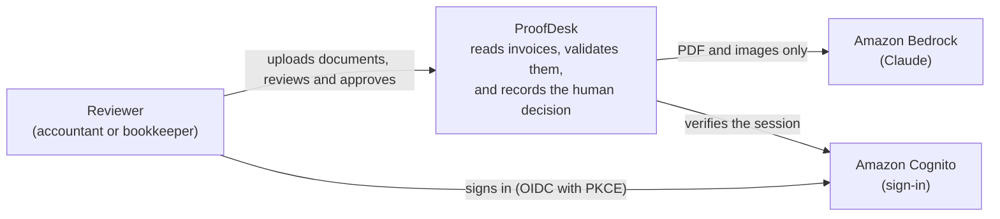
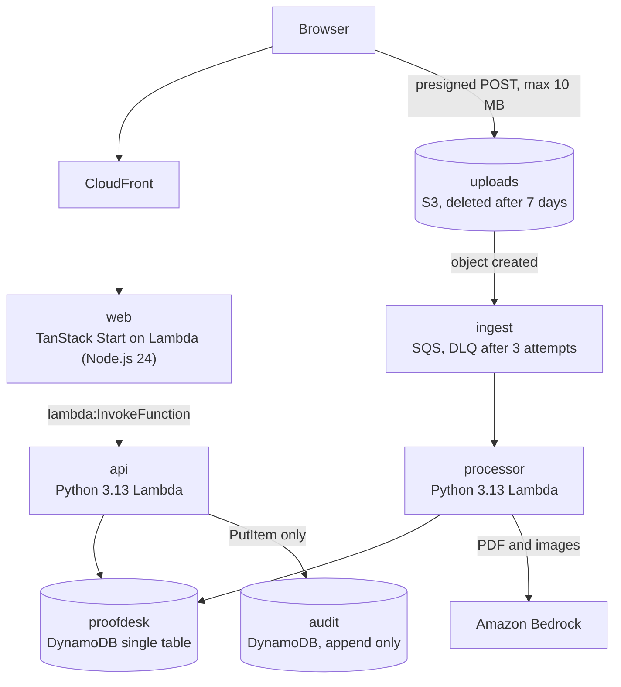
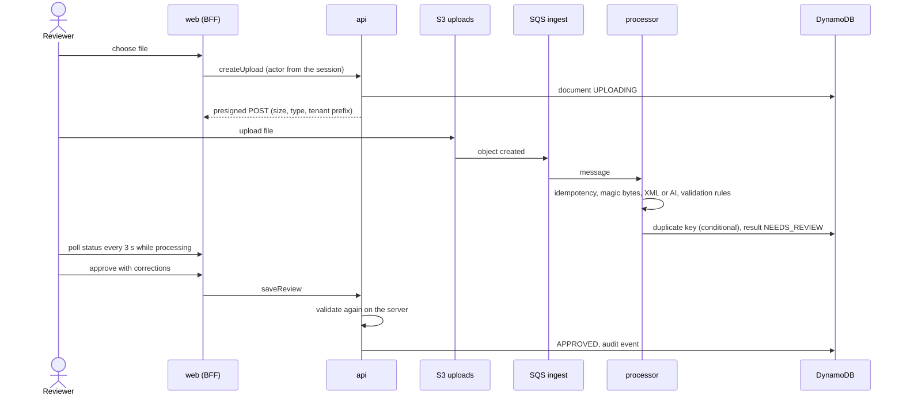
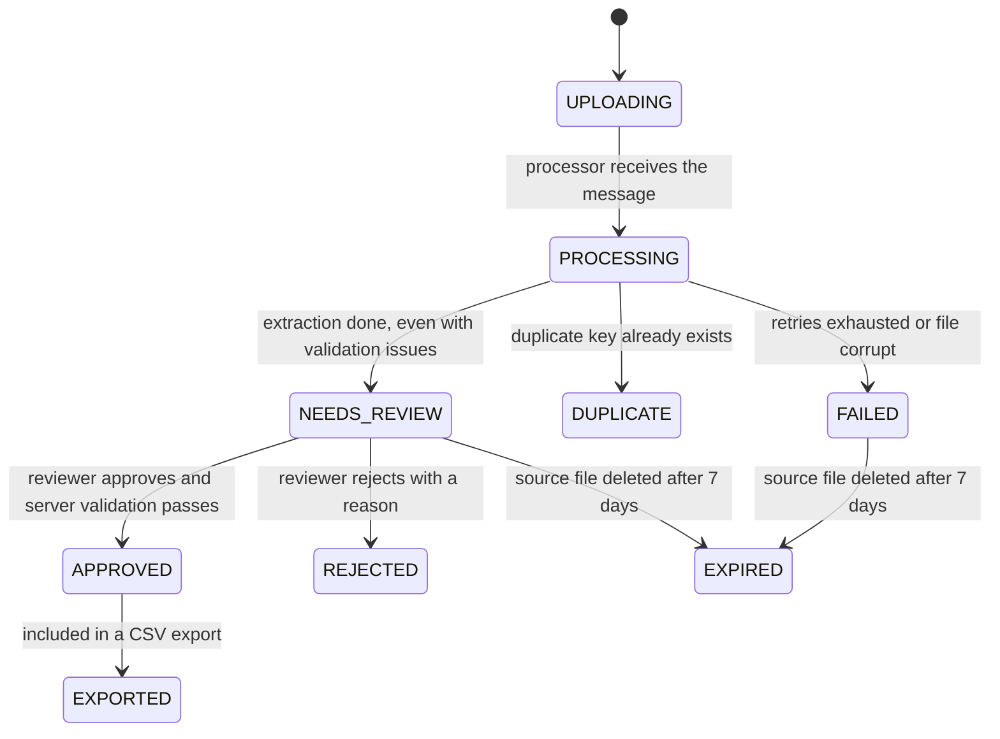

# Architecture

This document explains how ProofDesk is structured and why. It follows the C4 model: a
system context diagram, a container diagram, the main document flow and the document
lifecycle. Diagrams are Mermaid, so they are reviewed and versioned with the code.

**Status as of 2026-11-19:** only the Python domain core (`services/proofdesk`) exists.
Everything else on this page is the design for later milestones, and each section says which
milestone builds it. The page is updated in the same pull request that changes the design.

## Three principles

1. **The browser talks only to the web app.** The TanStack Start server (the backend for
   frontend, BFF) is the only public entry point.
2. **The BFF calls Python with an IAM-authorised Lambda invoke, not a public API**
   ([ADR-0001](decisions/0001-bff-invokes-python-lambda.md)). This removes a second public
   endpoint and its cost.
3. **Slow work is asynchronous.** Uploads go straight to S3, and processing runs from an SQS
   queue, so no user request waits on document parsing or on the model.

## System context

E-invoice XML never reaches the model. It is read by deterministic code, which is exact,
free, and keeps the data inside the account (ADR-0003, Milestone 1).

## Containers

| Container | Can do only this | Milestone |
| --- | --- | --- |
| `web` | Invoke the `api` function and read its own SSM parameters. No S3, DynamoDB or Bedrock access, so a compromised front end can do only what `api` allows | 5 |
| `api` | Read and write the `proofdesk` table, `PutItem` on `audit`, issue presigned URLs under `tenant/*` and `exports/*` | 2, 6 |
| `processor` | Read objects under `tenant/*`, write the `proofdesk` and idempotency tables, invoke one chosen Bedrock model | 2, 3 |
| `uploads` | Block Public Access on, TLS only, lifecycle deletion after 7 days, no versioning | 2 |
| `ingest`, `ingest-dlq` | Encrypted queues, `maxReceiveCount` 3, alarm on any DLQ message | 2, 7 |

## Main flow: one document

The `actor` (tenant, user, role) is always filled in by the BFF from the verified session,
never from data the browser sends.

## Document lifecycle

Every transition is a DynamoDB write with a `ConditionExpression` on the current status. If
two reviewers approve the same document, the second one receives a conflict instead of
overwriting the first decision.

## What exists today

| Part | Location | Status |
| --- | --- | --- |
| Money as exact `Decimal` | `services/proofdesk/src/proofdesk/contracts/money.py` | Implemented |
| Invoice contract, tax ID checks, totals, XML parser, duplicate key | `services/proofdesk/src/proofdesk/` | Milestone 1, in progress |
| Infrastructure (CDK in Python) | `infra/` | Milestone 2 |
| Web app | `apps/web/` | Milestone 5 |

Related documents: [requirements](requirements.md), [threat model](threat-model.md) and
[decisions](decisions/).
